# 作業記録：試作ゲーム「Markdown鍛造（仮）」を 1 日で作って公開するまで（2026-11-09）

ブログ記事の下書き用に、この日の作業の流れ・決めたこと・画面をまとめた記録です。
スクリーンショットは `images/` にあります。

- 遊べる場所: https://oosawak.github.io/md-forge/
- ソース: https://github.com/oosawak/md-forge
- 作業: Claude Code（Claude デスクトップアプリの Code タブ、macOS）

---

## 1. はじまり：ミューズ経由で Claude Code に仕事を渡す

ふだん使っているアシスタント AI「ミューズ」に指示書を書かせ、それを GitHub のリポジトリ（neta-cho）に置いて、ほかの AI に渡すという流れを使っています。
この日は、Claude Code がその流れに入れるかを確かめるところから始めました。

1. **往復テスト**（11:44〜11:50）
   指示書を読み、報告ファイルを書いて commit・push し、指示書に「状態: 完了」と追記する。読み・書き・push の往復ができることを確かめた。
2. **試作ゲームの依頼**（11:58 に指示書、12:22 に完了）
   「自分の手で武器を鍛造する → できた武器で自動バトル → 素材を集めてまた鍛造する」という遊びの芯だけを借りて、中身はオリジナルで作る試作。
   独自要素は「Markdown で数値を調整する」「Markdown を合成すると武器が強くなる」「主人公は VRM で、鍛えた剣を持たせる」。

最初の版（v1）はこんな形でした。

| なぞって削る鍛冶台（v1） | 横から見たバトル（v1） |
| --- | --- |
| 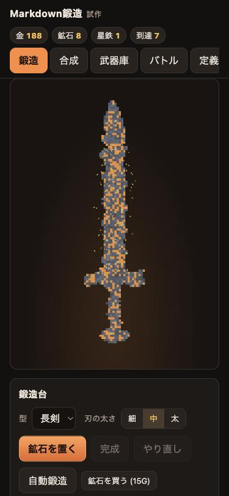 | 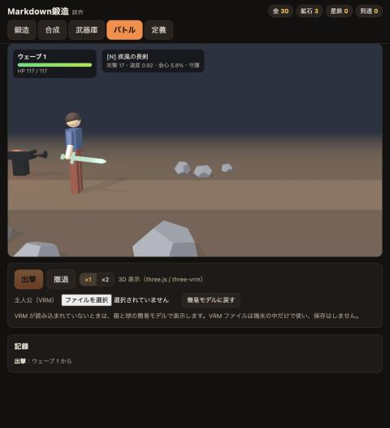 |

VRM のサンプルモデルを読み込むと、右手のボーンに鍛えた剣を持たせて振ります。

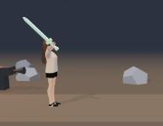

### v1 の作り

- `index.html` 1 枚。three.js と three-vrm は CDN（jsDelivr）から読み込む。読めないときは 2D 表示に切り替わる。
- 確率や換算の数値は `balance.md` と `fusion.md` の「`## 見出し` の下の最初の表」から読む。同じ内容を `index.html` にも埋め込んであり、ファイルが読めない環境でも動く。
- 削った形（マス目）から輪郭を取り出し、three.js の ExtrudeGeometry で厚みのある 3D の剣にして、VRM の右手に持たせる。

---

## 2. 鍛冶台を「砥石に押し当てて削る」形へ

> 依頼：いろいろな形の砥石を選べて、材料をドラッグして砥石に寄せると火花が出て、材料が削れるような形がいい

- 回る砥石を作業台の右側に固定し、鉱石のほうを動かして押し当てる形にした。
- 砥石は 4 種類（大砥石・小砥石・平砥石・尖り砥石）。形・大きさ・削る速さは `balance.md` の「## 砥石」の表で変えられる。
- 砥石に当たっている間は鉱石がゆっくりしか進まないので、押し当てている手応えが出る。
- 火花は砥石の回る向きに沿って飛び、削り口が赤く光る。

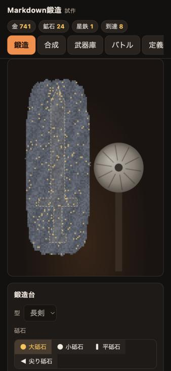

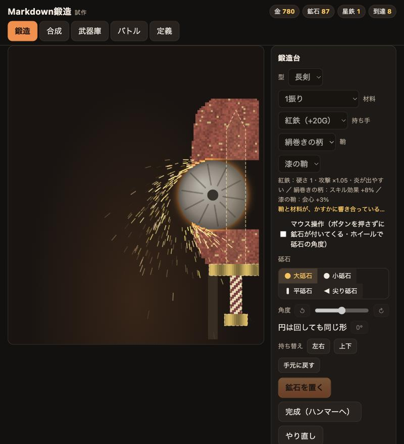

---

## 3. 別リポジトリにして GitHub Pages で公開

> 提案：このプロジェクトのソースは新しくリポジトリを作って、GitHub Pages で公開しながらやったらどうかな

- `oosawak/md-forge` を作り、main ブランチの直下を GitHub Pages で配信（13:42）。
- `.nojekyll` を置いて、`.md` ファイルを加工せずそのまま配信するようにした（ゲームが fetch で読むため）。
- 公開ページで、`balance.md` と `fusion.md` を内蔵の初期値ではなくファイルから読めていることを確かめた。
- これ以降の開発は md-forge で行い、URL を開くだけでスマホでも遊べるようになった。

---

## 4. 砥石の角度を変える

> 依頼：削り砥石は角度を変えられるといいな

- 平砥石と尖り砥石を、中心の軸のまわりで回せるようにした（ボタン・スライダー、パソコンでは Q / E キー）。
- 削る判定と火花の向きも、角度に合わせて回る。

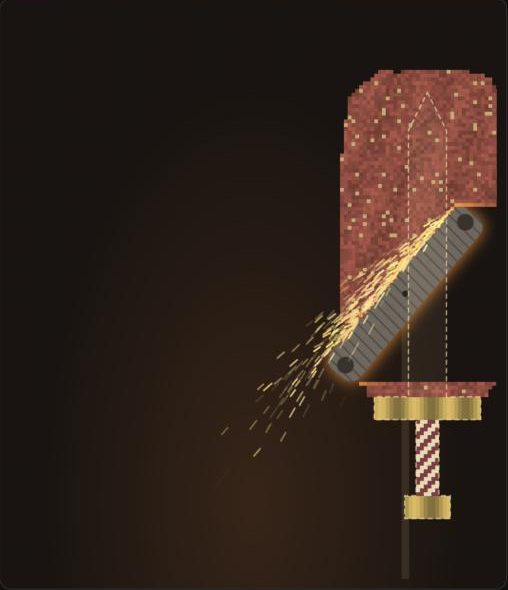

---

## 5. 材料・持ち手・鞘を選ぶ、組み合わせで「共鳴」

> 依頼：剣の鞘は最初に選択できるといいな。材料との組み合わせで、なにか起きてもいいし。

あとから「鞘じゃなく、持ち手かな」→「鞘はそのままにしよう」→「剣を削るのは、持ち手以外のところにしたいの」「今って持ち手も鍔も削るじゃん」と、やりとりしながら形を決めました。

- **材料**（鉄・銅・黒鉄・紅鉄・青晶）：鉱石の色、硬さ（削りにくさ）、性能、出やすい属性が変わる。
- **持ち手**（木の柄・革巻き・鮫皮・鋼・絹巻き）：鍔と柄は最初から鉱石に付いている部品で、砥石では削れない。砥石に当たるとそこで止まる。削るのは刀身だけ。
- **鞘**：剣に効果を 1 つ付ける。バトルでは腰に差す。
- **共鳴**：相性の良い鞘と材料の組み合わせだと、確率で共鳴して剣に銘が刻まれ、効果が上乗せされる（例：漆の鞘 × 紅鉄 → 銘「紅蓮」）。
- どれも `balance.md` の表で中身を変えられる。

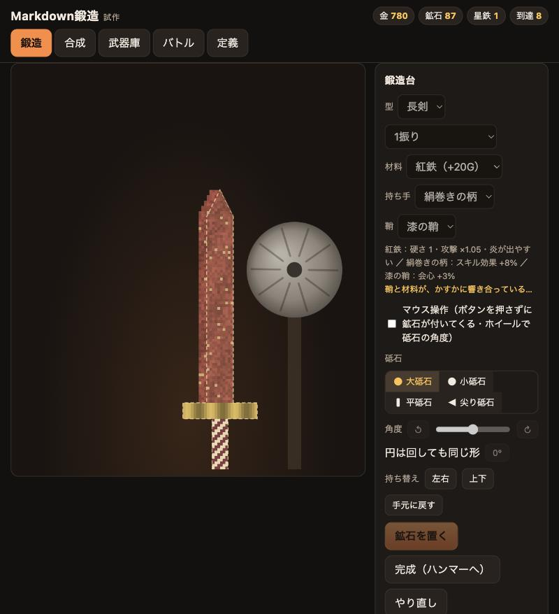

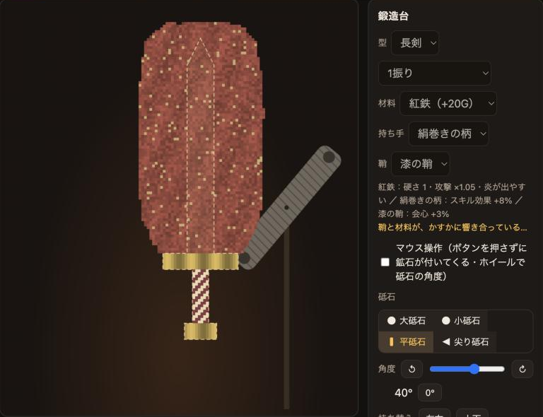

### マウス操作のチェックボックス

> 依頼：マウスでの操作のチェックボックスつけて、最初はオフがいい

オンにすると、ボタンを押さなくても鉱石がマウスに付いてきて、ホイールで砥石の角度を変えられる。最初はオフ。

---

## 6. ハンマーで叩いて能力を付ける

> 依頼：あとはハンマーで叩いて、能力が付加される感じの

- 「完成」を押すと、刀身が金床に移って赤く熱を持つ。
- 刀身に光る点が出て、その色で付く能力（攻撃・会心・速度・防御・スキル）が決まる。
- 点に向かって縮む輪が、点にぴったり重なった瞬間に叩くと「会心の一打」、少しずれると「良い一打」。
- 叩く回数・輪の速さ・判定の幅・付く値は `balance.md` の「## ハンマー」「## ハンマーの設定」で変えられる。

| 光る点と縮む輪 | 会心の一打 |
| --- | --- |
| 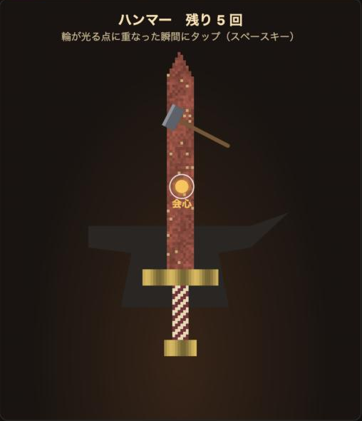 | 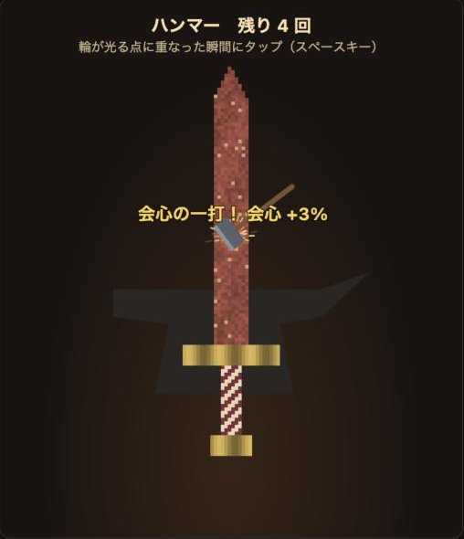 |

叩き終わると性能が決まり、何がどれだけ付いたかが出ます。この剣は共鳴して銘「紅蓮」が付きました。

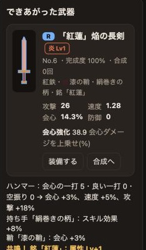

---

## 7. 1枚の鉱石から 2 振り、対の剣の二刀流

> 依頼：一枚の鉱石から２振りの剣つくれるとか
> 依頼：双子剣は連撃でダメージ加算されるとかいいよね

- 「2振り（1枚から）」を選ぶと、横長の 1 枚の鉱石に持ち手が 2 つ付いて出てくる。2 本の刀身を削り、ハンマーは左右交互に叩く。
- できた 2 本は「対の剣」。片方を装備して、もう片方が武器庫に残っていると、左手に対の剣を持つ二刀流になる。
- 右手の一撃のあと、確率で左手の対の剣が追撃する（確率と倍率は `balance.md` の「## 対の剣」）。

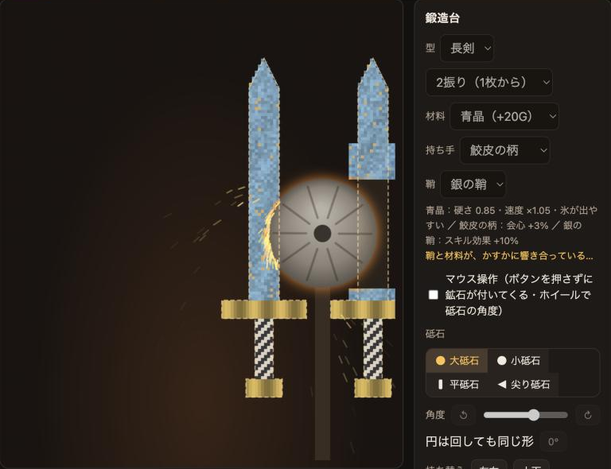

---

## 8. 斧と槍

> 依頼：斧とか槍もいいね

- 斧は弧を描く刃と長い柄、槍は木の葉形の穂先と長い柄。削れるのは刃と穂先だけで、柄は持ち手の部品。
- 3D では型ごとに長さを変えた。

| 斧（黒鉄・鋼の柄、2振り） | 槍（銅・革巻きの柄、2振り） |
| --- | --- |
| 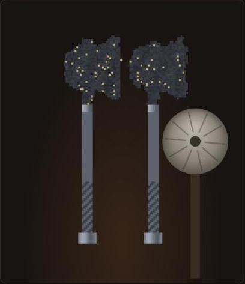 | 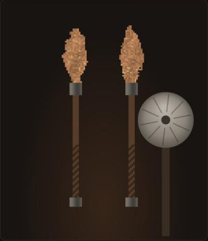 |

---

## 9. バトルを斜め見下ろしの、上へ進むステージに

> 依頼：バトルは、横スクロールじゃなく、斜め見下ろし型でボスは結構でかくとかいいよね。縦方向にステージを進んでく感じで。ウェーブ毎に上に向かって、ステージがすすんでくの

- カメラを主人公の右後ろ上に置き、画面の上へ続く 1 本道を見下ろす形にした。
- 敵は道の上から来る。ウェーブを突破すると、主人公が次の区切り（かがり火の柱）まで歩いて上へ進む。
- 5 ウェーブごとに、大きな門の先から巨大なボスが来る。

| 二刀流で戦う | 対の剣の追撃 |
| --- | --- |
| 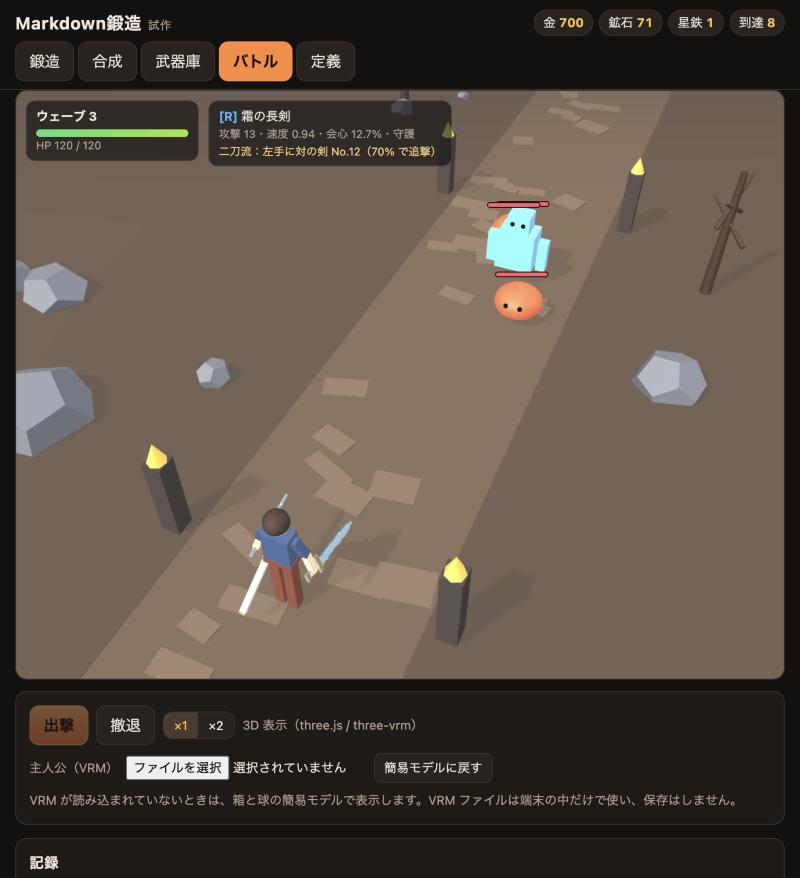 | 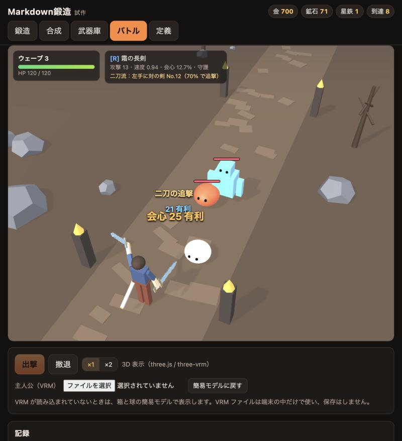 |

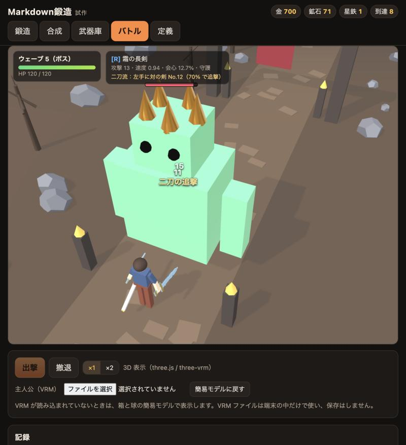

### 視点の切り替え（斜め／縦）

> 依頼：画面が斜めになってます。この表示は残したまま、画面・地面が縦方向に移動していくようなものもできませんか？

バトル画面の下に「斜め／縦」の切り替えを足しました。「縦」では真後ろ上から見下ろすので、道が画面の下から上へまっすぐ続き、ウェーブごとに地面が縦にスクロールしていきます。選んだ視点は端末に覚えておきます。

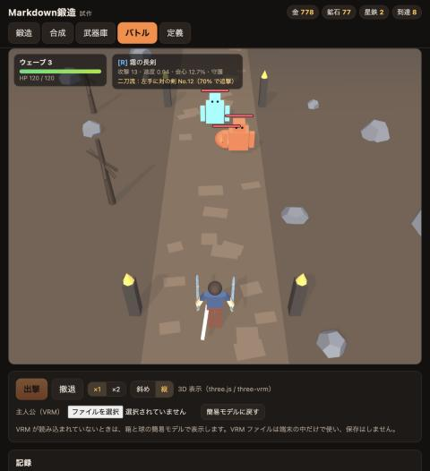

### 縦の視点では、主人公を動かせる

> 依頼：この縦のモードのときに、プレイヤーを操作できて。敵はいろんな方向からポップするってできる？
> 依頼：画面の左右には木とかが生えててもいいですね。

- 「縦」で出撃すると、主人公を自由に動かせる。パソコンは矢印キーか WASD、スマホは画面をドラッグ（指を置いた所に仮想スティックが出る）。
- 敵は前・横・うしろのいろいろな向きから現れて、主人公に寄ってくる。主人公は届く範囲のいちばん近い敵を自動で攻撃し、そちらを向く。
- ウェーブを突破したら、自分で上へ歩いて次の区切りへ。しばらく操作しなければ自動で歩く。
- 道の左右に、針葉樹と丸い葉の木の森を足した。
- 「斜め」で出撃したときは、これまでどおりの自動バトル。

| 自由に動いて戦う | スマホの仮想スティック |
| --- | --- |
| 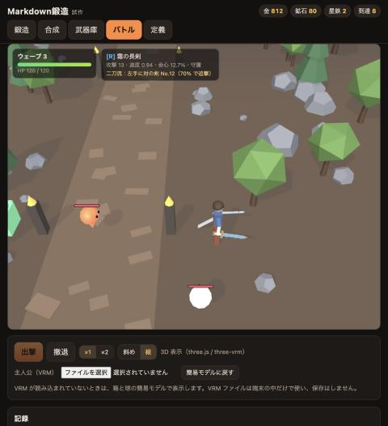 | 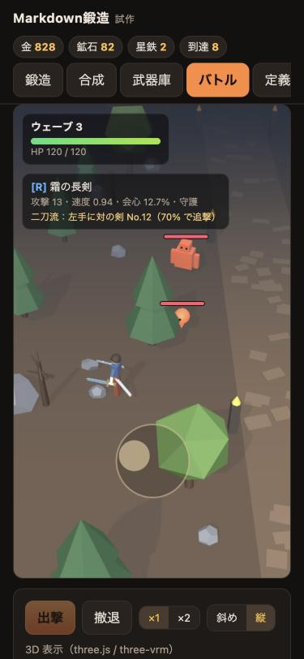 |

スマホの縦長の画面でも、道の左右が切れないようにカメラを引いています。

| スマホ幅のバトル | スマホ幅の鍛冶台（2振り） |
| --- | --- |
| 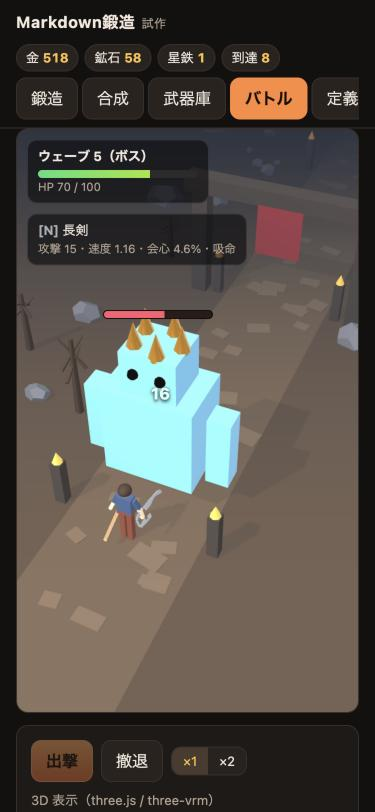 | 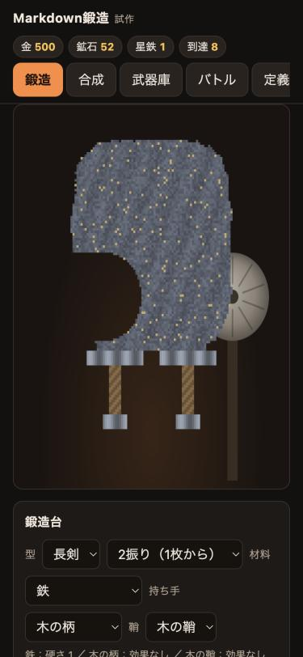 |

---

## 作業の進め方で良かったこと

- **依頼は一言ずつ、すぐ形にして見る。** 「鞘じゃなく持ち手」「鍔も削れてしまう」のように、動くものを見てから言葉が出てくることが多かった。小さく作って見せ、ずれていたら直す、を繰り返した。
- **数値はぜんぶ Markdown の表に出す。** 砥石・材料・持ち手・鞘・共鳴・ハンマー・対の剣まで、`balance.md` の表を書き換えれば変わる。コードを読まなくても調整できる。
- **公開しながら作る。** GitHub Pages に置いたことで、push するたびに URL で最新版を確かめられた。
- **確かめたことと、確かめていないことを分けて書く。** 毎回、手元のブラウザで動作を確かめ、試していないこと（スマホ実機など）は報告に残した。

## まだのこと

- スマホ実機でのタッチ操作の確認（ブラウザのスマホ幅表示でのみ確認）
- 3D が使えないときの 2D の代替表示（`?2d`）は、古い横から見た表示のまま
- 槍の「突き」の動き（今は剣と同じ振り下ろし）
- 手持ちの VRM での見え方（確認は three-vrm のサンプルモデルのみ）

## 作業の記録（commit）

neta-cho（ミューズとのやりとり用）

| 時刻 | 内容 |
| --- | --- |
| 11:44 | Claude Code 往復テスト報告 |
| 11:50 | 往復テスト指示書を完了にする |
| 12:22 | 試作ゲーム Markdown鍛造（仮）を追加し報告を書く |
| 13:41 | 鍛冶台を砥石式に変更 |
| 13:43 | oosawak/md-forge へ移して公開したことを報告に追記 |

md-forge（ゲーム本体）

| 時刻 | 内容 |
| --- | --- |
| 13:42 | neta-cho から移して公開 |
| 13:47 | 砥石の角度を変えられるようにする |
| 13:54 | 材料と鞘を選べるようにし、組み合わせで共鳴が起きるようにする |
| 14:00 | 持ち手を選べるようにし、鍔と持ち手は削れない部品にする |
| 14:04 | 完成の前にハンマーで叩いて能力を付ける工程を足す |
| 14:09 | 1枚の鉱石から 2 振り打てるようにする |
| 14:11 | 武器の型に斧と槍を足す |
| 14:12 | 対の剣を二刀流にして追撃できるようにする |
| 14:17 | バトルを斜め見下ろしの、上へ進むステージにする |

## 使ったもの

- three.js 0.160.0 / @pixiv/three-vrm 2.1.0（jsDelivr の CDN）
- 動作確認用の VRM：three-vrm 公式リポジトリのサンプルモデル
- 敵・地面・岩・木・門・金床は、すべて three.js の基本図形で作った（外部の 3D モデルは使っていない）
